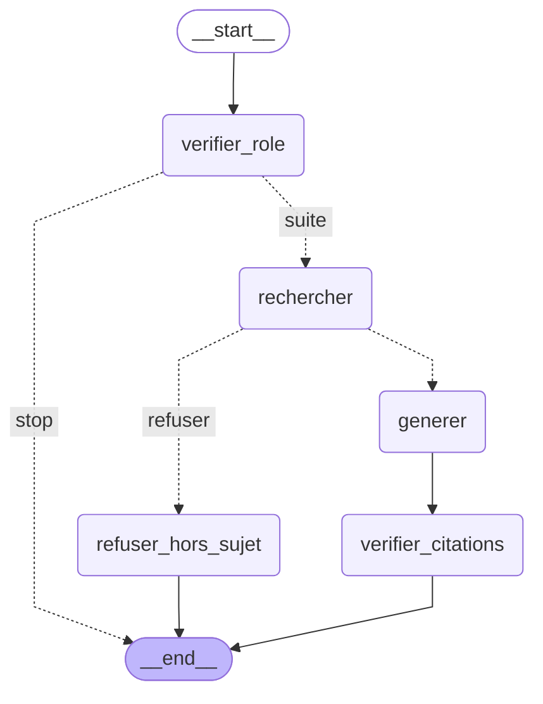

# Architecture

## Schéma général

## Flux d'une question

1. L'utilisateur se connecte et pose une question.
2. L'API identifie son rôle grâce au jeton JWT.
3. L'agent LangGraph vérifie les permissions de ce rôle.
4. La recherche ne porte que sur les documents autorisés (filtre appliqué avant la récupération).
5. Les passages trouvés sont reclassés par le reranker.
6. Le LLM répond uniquement à partir de ces passages et cite ses sources.
7. Si aucun document autorisé ne répond, l'assistant refuse ou dit qu'il ne sait pas.

## Pipeline d'ingestion

Documents (PDF, DOCX, MD) → extraction du texte → découpage en chunks → métadonnées (département, confidentialité, rôles, version, date) → embeddings `bge-m3` → Qdrant.