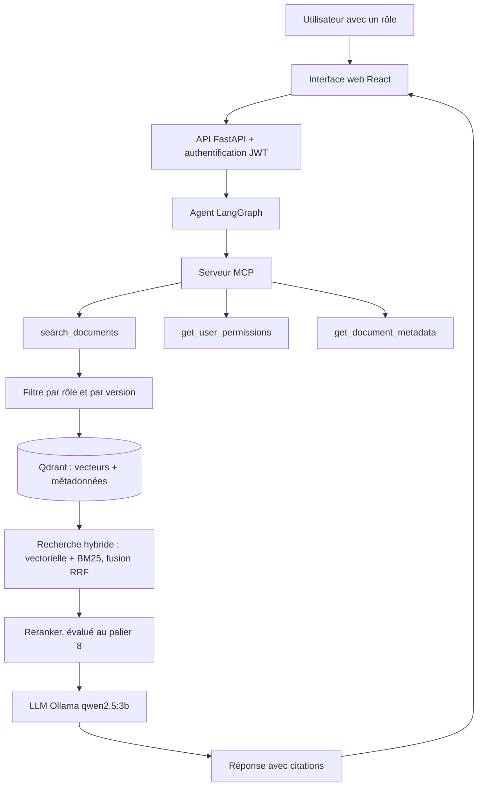
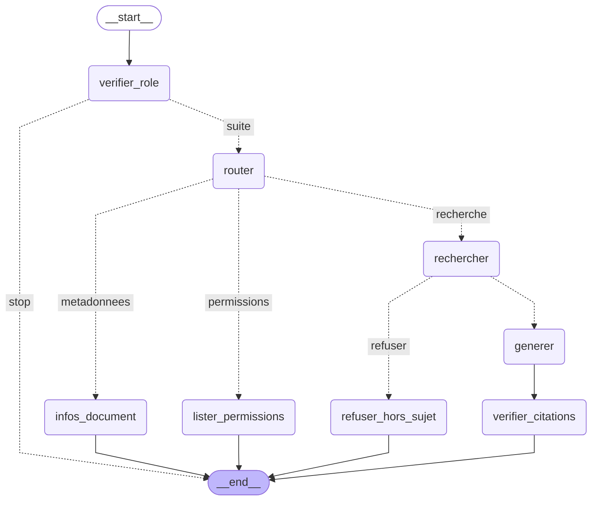

# Architecture

## Schéma général

## Flux d'une question

1. L'utilisateur se connecte et pose une question.
2. L'API identifie son rôle grâce au jeton JWT.
3. L'agent LangGraph vérifie le rôle.
4. La recherche ne porte que sur les documents autorisés et en vigueur (filtre appliqué avant la récupération).
5. La recherche hybride fusionne le classement vectoriel et le classement BM25.
6. Si le meilleur score est sous le seuil, l'assistant refuse sans appeler le LLM.
7. Sinon, le LLM répond uniquement à partir des passages retrouvés et cite ses sources.
8. Une réponse sans citation est transformée en refus.

## Graphe de l'agent

## Pipeline d'ingestion

Documents Markdown + manifeste YAML → validation des faits clés → découpage par sections → métadonnées (département, confidentialité, rôles autorisés, version, statut, empreinte) → embeddings `bge-m3` → Qdrant.

L'ingestion est incrémentale : une empreinte (hash) du contenu et des métadonnées détecte les documents ajoutés, modifiés ou supprimés, et seuls ceux-là sont réindexés.
